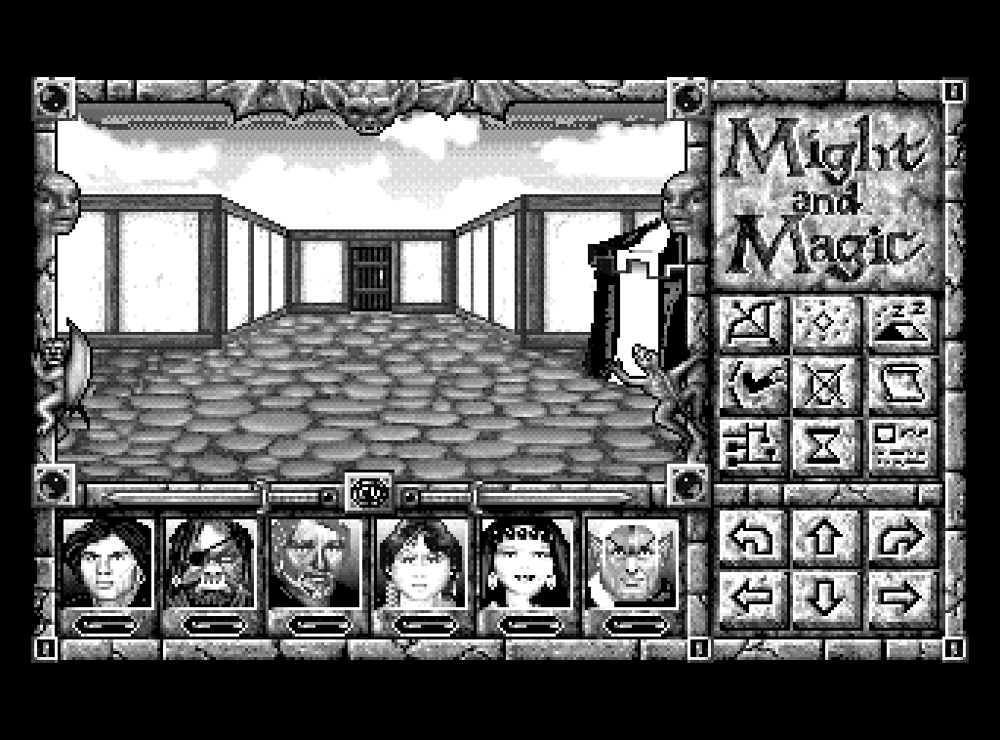
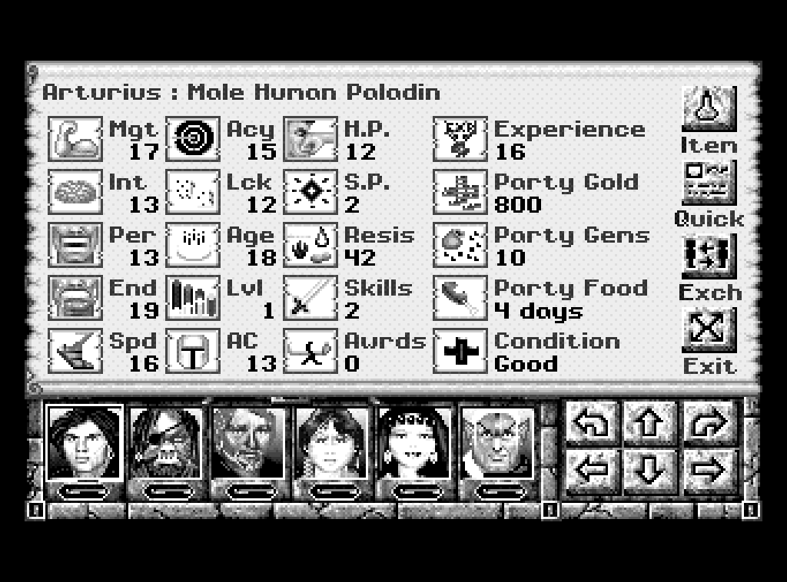
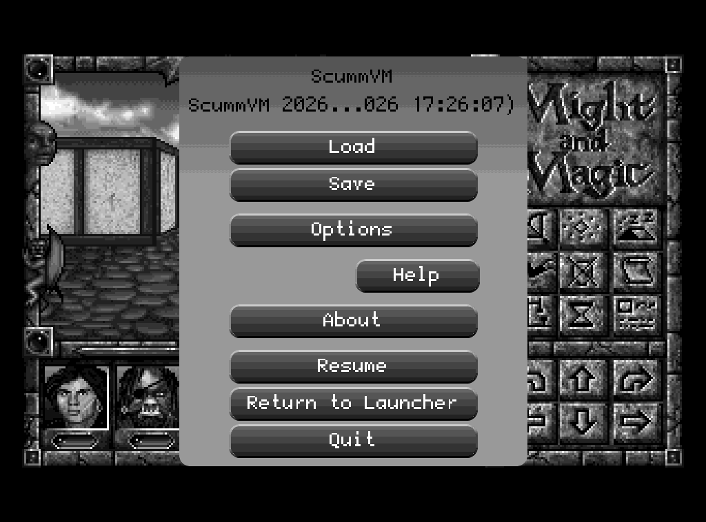
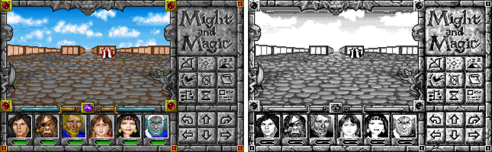

#Might and Magic: World of Xeen on a PocketBook e-reader

Play **Might and Magic IV & V (World of Xeen)** on a **[PocketBook Touch Lux 5](https://github.com/jvanheerikhuize/pocketbook_lux_5)**
e-ink reader. This repo is a [ScummVM](https://www.scummvm.org/) backend for
[PocketBook's InkView SDK](https://github.com/blchinezu/pocketbook-sdk), tuned for a turn-based game on a 16-gray, slow
panel: a colour-to-gray mapping that keeps text readable, a refresh policy
that keeps ghosting down without flashing, touch play, and saves that survive
the reader going to sleep.


Xeen is turn-based and only redraws when you act, which suits e-ink. At 3x
the game fills the panel (960x600 of 1024x758) and its own icons are large
enough to tap.

> You need your own copy of the game (World of Xeen is sold by [GOG](https://www.gog.com/en/game/might_and_magic_6_limited_edition)). No game
> data is included here or in the release.

## Screenshots

What the panel shows (rendered by the backend's host build, 1024x758):

| | |
|---|---|
|  |  |
|  |  |

Colour to 16 grays: saturated colours (green and orange text, blue boxes)
take whichever gray stands out from their surroundings, then a Bayer dither:



## Features

- **Full screen landscape** at 3x, centred. Hold the reader turned a quarter
  counter-clockwise (buttons on the right).
- **Touch play**: tap the game's own icons, arrows and portraits.
- **Buttons**: MENU = Escape; hold MENU = ScummVM menu (save, load, options).
  PREV/NEXT also move.
- **Text prompts** (character names, riddles, amounts) open the reader's
  keyboard automatically.
- **Resume where you left off**: leaving the app saves (slot 99), a safety
  save is made every 2 minutes, and the next launch resumes the newest save.
- **E-ink refresh policy**: fast partial updates while you play, a full
  refresh only when the screen has settled or ghosting has built up.
- **Home-screen icon**, optional.
- **Portrait mode** with a 36-button touch keypad (game at 2x), if you prefer.

## Requirements

- A PocketBook **Touch Lux 5 (PB628)**, firmware 6.x. It was developed and
  tested on U628.6.9. Other 1024x758 PocketBooks with firmware 6.x may work;
  reports are welcome.
- **Might and Magic: World of Xeen** data files `xeen.cc`, `dark.cc`,
  `intro.cc`. [GOG](https://www.gog.com/en/game/might_and_magic_6_limited_edition) sells it as "Might and Magic 4-5" (Windows installer).
- No sound: the reader has no audio output.

## Install

1. Download `mmiv-1.0.0-pocketbook.zip` from
   [Releases](https://github.com/jvanheerikhuize/mmIV/releases) and unzip it.
2. Get the game files out of the GOG installer on a Linux/macOS PC with
   [innoextract](https://constexpr.org/innoextract/):
   ```sh
   innoextract setup_might_and_magic_4-5_*.exe -d xeen
   ```
   The files you need are `xeen/__support/save/XEEN.CC`,
   `xeen/__support/save/DARK.CC` and `xeen/INTRO.CC` (take `XEEN.CC` and
   `DARK.CC` from `__support/save/`, not from the top folder). Or run
   `tools/prepare-gog-data.sh` from this repository, which picks them out and
   checks them against ScummVM's detection table.
3. Connect the reader over USB and copy the zip's `applications` folder onto
   its internal storage, merging with the existing `applications` folder.
4. Copy the three game files into `applications/mmiv/game/` on the reader.
5. Eject. **mmiv** is in the Applications list.

Optional home-screen icon: with the reader still connected, run
`python3 install-icons.py /path/to/reader` (in the zip). It adds one entry to
the firmware's `system/config/desktop/view.json` and keeps a backup next to
it. Restart the reader to see the icon.

## Playing

| Action | How |
|---|---|
| Move, turn, use icons, pick party members | Tap them in the game |
| Escape / close a dialog | MENU (short press) |
| Save, load, options, quit | Hold MENU (ScummVM menu) |
| Type a name or an answer | The keyboard opens by itself; OK confirms, cancel = Escape |
| Pause | Press Home or let the reader sleep; the game saves and resumes next time |

**Layout**: create a text file `applications/mmiv/layout` containing
`landscape` (default), `landscape-flip` (held the other way round) or
`portrait` (2x with a touch keypad below).

Saves are ScummVM saves in `applications/mmiv/saves/`. They work in desktop
ScummVM too, so you can move a game between the reader and a PC. The log is
`applications/mmiv/scummvm.log`.

## Building

Everything builds on an x86-64 Linux PC (developed on Ubuntu).

### Prerequisites

```sh
sudo apt install build-essential git python3 python3-pil zip innoextract
sudo apt install libsdl2-dev      # optional: play on the PC (SDL build)
```

The **PocketBook SDK** (GCC 6 cross compiler, glibc 2.23, InkView): branch
`6.5` of [pocketbook/SDK_6.3.0](https://github.com/pocketbook/SDK_6.3.0),
tree `SDK-B288`:

```sh
mkdir -p ~/opt/pocketbook-sdk
git clone --depth 1 --branch 6.5 https://github.com/pocketbook/SDK_6.3.0 \
    ~/opt/pocketbook-sdk/SDK_6.3.0-6.5
```

The scripts look for it there; set `SDK=/path/to/SDK-B288` to use another
location.

### Source

```sh
git clone https://github.com/jvanheerikhuize/mmIV
cd mmIV
git submodule update --init --depth 1    # ScummVM v2026.4.0
```

ScummVM is a submodule kept unmodified in git. `tools/link-backend.sh` (run
by the build scripts) links `backend/pocketbook/` into it and applies
`patches/`:

| Patch | Why |
|---|---|
| 0001 | `configure`: the `pocketbook` backend |
| 0002 | Xeen: ask for the on-screen keyboard while typing |
| 0003 | GUI: a tap keeps a pop-up list open on touchscreens |
| 0004 | Xeen: no saves while signing in at an inn (they could not be loaded) |

### Build for the reader

```sh
tools/build-device.sh pocketbook        # -> build/device-pocketbook/scummvm
tools/make-release.sh 1.0.0             # -> dist/mmiv-1.0.0-pocketbook.zip
```

`tools/make-bundle.sh --install` builds a bundle that includes your game files
from `~/games/xeen` (see `tools/prepare-gog-data.sh`) and copies it straight
onto a connected reader at `/run/media/$USER/PB628`. It also installs the
icon.

### Build and test on the PC

```sh
tools/build-host.sh pocketbook    # the e-ink backend with a headless stub
tests/run.sh                      # unit, launcher, scripted play and golden tests
tools/build-host.sh sdl           # optional: ordinary ScummVM window
```

The host stub runs the real backend, writing each panel frame as a PGM and
reading scripted input (`tools/run-host-script.sh`, scripts in
`tests/host/`). The golden tests compare coarse 40x25 block signatures, so no
game imagery is committed. The unit tests (`make -C tests/unit`) need only a
C++ compiler and run in CI. The scripted tests need your game data in
`~/games/xeen` with a save in slot 0.

`tools/make-screenshots.sh` regenerates the screenshots above.

### Develop on the reader with pbtk

The device build links in pbtk's agent (`backend/pocketbook/pbagent/`), so
[pbtk](https://github.com/jvanheerikhuize/pocketbook_lux_5) can take
screenshots, tap, press keys, stream `scummvm.log` and redeploy over Wi-Fi
while the game runs. The agent stays off unless the reader has pbtk's token,
so release builds are unaffected.

```sh
pbtk deploy --build --eject            # first time, over USB: bundle + agent token
pbtk deploy --wifi --restart --build   # after that: changed files only, restart in place
pbtk shot; pbtk tap X Y; pbtk logs -f  # or `pbtk gui`; Claude Code uses .mcp.json
```

`pbtk.toml` keeps the saves on the reader: a deploy never overwrites them. A
restart (and closing the app) first saves to slot 99, then runs `mmiv.app`
again, which resumes the newest save.

## How it works

```
 InkView main thread                     engine thread (ScummVM + Xeen)
 ───────────────────                     ──────────────────────────────
 touch, keys, keyboard ──► input queue ──► OSystem_PocketBook::pollEvent
                                           (keys paced for Xeen's 5-event queue)
 panel updates  ◄── refresh policy ◄────── EinkGraphicsManager
 (Partial/Full)     (dirty boxes,          palette -> 16 grays (gray-map),
                     ghosting budget)      3x scale, Bayer dither
```

- `backend/pocketbook/pocketbook.cpp`: the `OSystem`: events, timers, saves
  on suspend.
- `eink-graphics.cpp`, `gray-map.cpp`: 8-bit game screen to the panel's 16
  grays. A per-palette lookup on CIE L*, contrast-aware for saturated
  colours.
- `refresh-policy.cpp`: when to do partial or full updates.
- `layout.cpp`: where the game sits; the landscape picture is rotated in
  software because the firmware's landscape mode misplaced it.
- `platform-inkview.cpp`: the reader (InkView). `platform-host.cpp`: the PC
  stub used by the tests.

`PLAN.md` has the design notes and the history; `device/results/` has the
logs of every session on the reader.

## Status

1.0: World of Xeen is fully playable on the PB628. Ideas for later are a
settings screen (refresh, dither, contrast), other PocketBook models, and
offering the backend to ScummVM upstream. Issues and pull requests are
welcome, especially test reports from other PocketBook models.

## License and credits

mmIV is GPL-3.0-or-later (see `LICENSE`), like ScummVM, which it builds on;
the release binary is ScummVM with this backend and the patches above.

Might and Magic and World of Xeen are trademarks of their owners; this project
is not affiliated with them, with GOG, with PocketBook or with the ScummVM
team. The screenshots show the game for illustration; the game data stays
with its owners.

Thanks to the ScummVM team for the Xeen engine.
